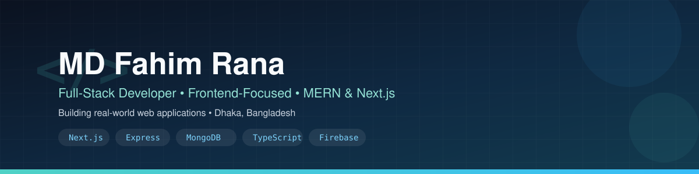

 

  
  
  
  

## Hi, I'm Fahim 👋

Computer Science student at **Bangladesh University of Professionals (BUP)**, based in Dhaka. I build full-stack web applications and take them all the way from schema design to deployment — and lately I've been going deeper into **AI systems**: retrieval-augmented generation, agentic workflows, and evaluation.

I'm looking for **Frontend / Full-Stack Developer internship and entry-level opportunities** where I can own real features and keep learning from a strong team.

- 🔭 Currently building an **agentic RAG copilot** for enterprise IT support (LangGraph + FastAPI + FAISS)
- 🌱 Going deeper into **system design**, **API architecture**, and **RAG evaluation**
- 🧪 Next up: fine-tuning **BanglaBERT** for Bangla fake-news detection
- ⚡ I enjoy debugging deployment issues almost as much as building features

## Tech stack

| Area | Tools |
|---|---|
| **Frontend** | React · Next.js · TypeScript · JavaScript · Tailwind CSS · Framer Motion |
| **Backend** | Node.js · Express · FastAPI · REST APIs · JWT · Firebase Auth |
| **Data & AI** | MongoDB · PostgreSQL · Prisma · FAISS · LangGraph · Gemini · Groq |
| **Tooling** | Git · Docker · Vercel · Render · Postman · VS Code |

## Selected work

### 🤖 [Enterprise IT Support — Agentic RAG Copilot](https://github.com/fahim3101/Helpdesk-Agentic-RAG)
Private-knowledge-first IT support assistant: retrieves from an internal handbook, grades its own evidence, rewrites weak queries, falls back to web search, and answers with sources. Ships with a RAG evaluation harness and audit logging.

`LangGraph` `FastAPI` `FAISS` `Gemini` `Groq` `SQLite` `Docker`
[Live demo](https://it-support-agentic-rag.onrender.com) · [Repository](https://github.com/fahim3101/Helpdesk-Agentic-RAG)

---

### 🛡️ [Centralized Enterprise Server Services](https://github.com/fahim3101/centralized-enterprise-server-services)
A production-grade Cisco Packet Tracer lab: centralized DNS, HTTP/HTTPS and Email for a headquarters plus four remote branches over an OSPF/IPsec WAN, with HSRP redundancy, ACL-based department isolation and NAT/PAT at the internet edge. 42 devices, fully documented.

`Cisco Packet Tracer` `OSPF` `IPsec` `HSRP` `VLAN` `ACL` `NAT/PAT`
[Repository](https://github.com/fahim3101/centralized-enterprise-server-services)

---

### 💰 [CrowdFundHub — Crowdfunding Platform](https://github.com/fahim3101/CrowdFundHub-client)
Full-stack crowdfunding platform with Firebase-verified auth, Stripe checkout, and role-based dashboards for supporters, creators and admins. The API includes a credit and withdrawal engine.

`React` `Express` `MongoDB` `Firebase` `Stripe` `TypeScript`
[Live app](https://crowd-fund-hub-client.vercel.app) · [Client repo](https://github.com/fahim3101/CrowdFundHub-client) · [Server repo](https://github.com/fahim3101/CrowdFundHub-server)

---

### 📚 [BoiBazaar — Used Textbook Exchange](https://github.com/fahim3101/boibazaar-client)
Marketplace for students to buy, sell and exchange secondhand university textbooks, built with server-side rendering, authentication and a database-backed catalog.

`Next.js 14` `TypeScript` `Express` `MongoDB` `Firebase Auth`
[Live app](https://boibazaar-client.vercel.app) · [Client repo](https://github.com/fahim3101/boibazaar-client) · [Server repo](https://github.com/fahim3101/boibazaar-server)

---

### 🎨 [Portfolio — "Build Log"](https://github.com/fahim3101/Portfolio)
My personal portfolio, designed around a git-commit visual language: diff-style skill tags, monospace commit hashes, and a scroll-linked commit-graph line. Data-driven content and per-project case-study pages.

`React 18` `Vite` `Tailwind CSS` `Framer Motion` `React Router`
[Live site](https://fahimrana.vercel.app/) · [Repository](https://github.com/fahim3101/Portfolio)

## 🧪 Currently building

### 📰 [Bangla Fake News Classifier](https://github.com/fahim3101/bangla-fake-news-classifier)
Binary classification of Bangla news articles, comparing a TF-IDF + classical ML baseline against a fine-tuned **BanglaBERT**, with accuracy, macro F1, training cost and error patterns reported side by side. Work in progress — tracked day by day in [`PROGRESS.md`](https://github.com/fahim3101/bangla-fake-news-classifier/blob/main/PROGRESS.md).

`Python` `scikit-learn` `TF-IDF` `BanglaBERT` `Hugging Face`

## Also built

| Project | What it is | Stack |
|---|---|---|
| [Lifeline](https://github.com/fahim3101/blood-donation-client) | Blood donation platform connecting donors and patients · [live](https://blood-donation-client-indol.vercel.app) | React · Express · MongoDB |
| [DriveFleet](https://github.com/fahim3101/drivefleet-client) | Car rental marketplace with booking flow and admin center · [live](https://drivefleet-client.vercel.app) | React · Express · MongoDB |
| [EventPilot](https://github.com/fahim3101/EventPilot-frontend) | Event marketplace with search, auth and organizer tools | Next.js · TypeScript · Express |
| [PostgreSQL-Test](https://github.com/fahim3101/PostgreSQL-Test-client) | E-commerce storefront and API on Prisma + PostgreSQL | React · Express · Prisma |
| [Job-Tracker](https://github.com/fahim3101/Job-Tracker) | Vanilla JS app to log applications and track stages | HTML · CSS · JavaScript |
| [KeenKeeper](https://github.com/fahim3101/Keenkeeper) | Personal relationship manager that tracks interactions | React · Tailwind |

## GitHub stats

## Let's connect

I'm actively looking for **Frontend / Full-Stack internship and entry-level opportunities**. If you're hiring — or just want to talk about RAG systems, API design or deployment war stories — my inbox is open.

📧 [fahimrana3101@gmail.com](mailto:fahimrana3101@gmail.com) · 💼 [LinkedIn](https://linkedin.com/in/fahim-rana) · 🌐 [fahimrana.vercel.app](https://fahimrana.vercel.app/)

> 📌 The six pinned repositories on this profile mirror the selected work above.
